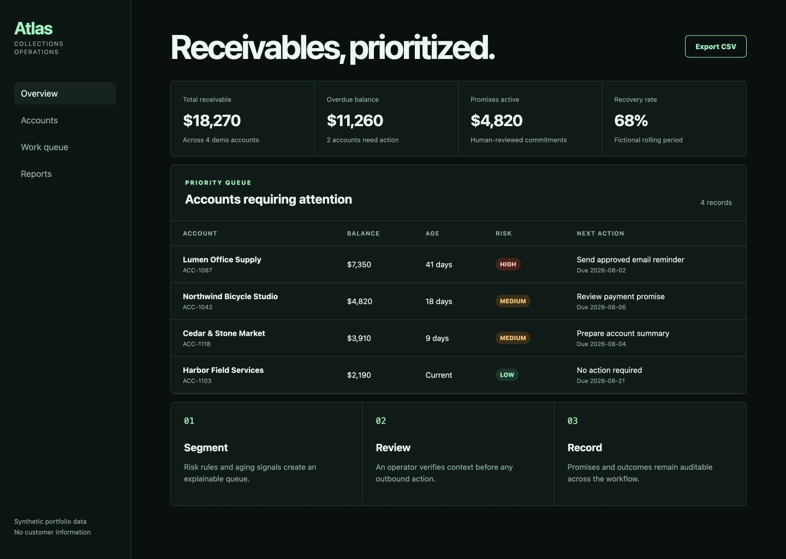

# Collections Operations Platform

A privacy-safe Next.js demonstration of a receivables workflow: portfolio visibility, explainable prioritization, promise tracking, and human-reviewed next actions.




## Public-project boundary

This repository was created with a fresh history and fictional records. It does not contain client names, documents, credentials, branding, messages, or source history from any commercial implementation.

## Features

- Responsive operations dashboard with portfolio KPIs.
- Deterministic risk and aging prioritization.
- Synthetic account queue with an explicit next action.
- Read-only JSON endpoints for accounts and summary metrics.
- Unit tests for calculation and prioritization rules.
- No authentication or outbound messaging in demo mode.

## Stack

Next.js 16, React 19, TypeScript, CSS, Node test runner, and GitHub Actions-ready scripts.

## Run

```bash
npm install
npm run dev
```

Open [http://localhost:3000](http://localhost:3000).

## Verify

```bash
npm test
npm run typecheck
npm run build
```

## API

- `GET /api/summary`
- `GET /api/accounts`
- `GET /api/export` - downloads the fictional account dataset as CSV

All endpoints return only the bundled fictional dataset.

## Production evolution

A production deployment would add PostgreSQL persistence, tenant isolation, RBAC, audited mutations, queue-backed jobs, encrypted document storage, rate limits, and an approved email provider. Those integrations are intentionally absent from this public demo so it remains safe and easy to review.

## Author

Built by **Jesus Perez** as a sanitized software-engineering portfolio project.
